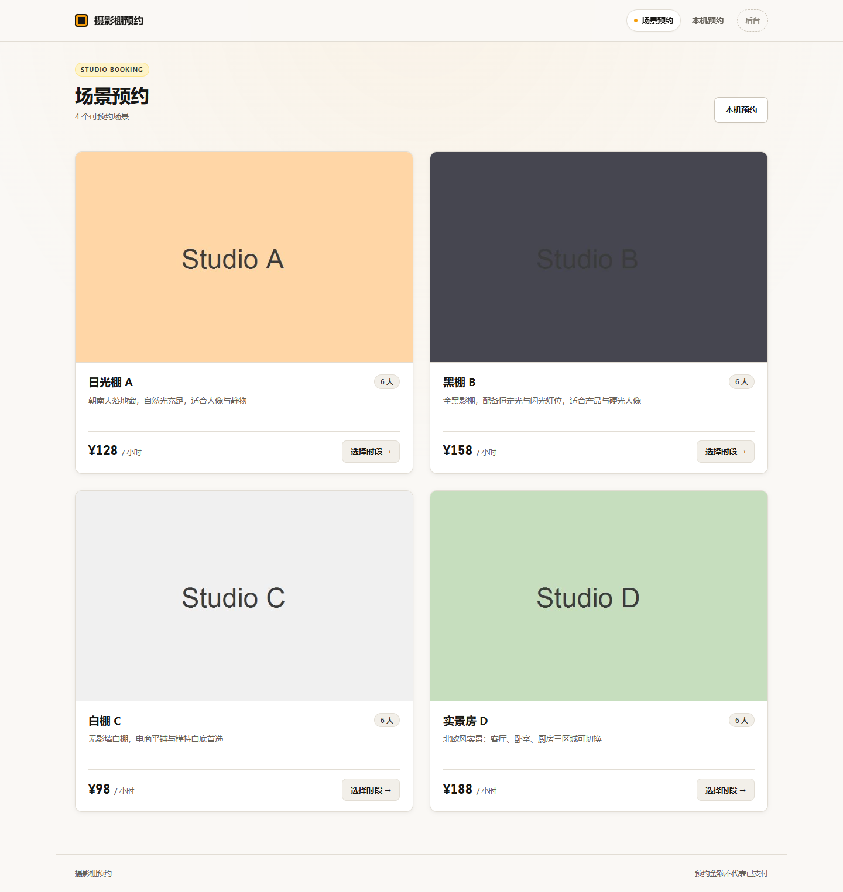
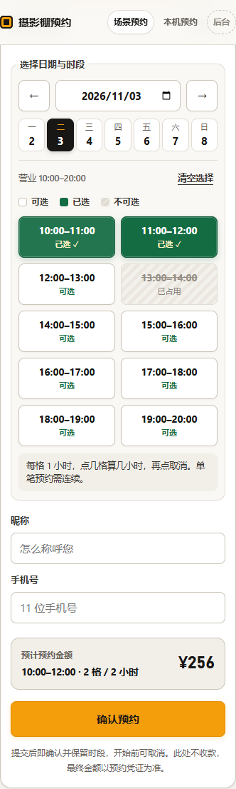

# Studio Booking · 摄影棚预约平台

从选择场景、逐小时预约，到私密凭证与到店核验的一体化摄影棚预约作品。

**[打开在线演示](http://47.109.43.77:3000/)**

> 当前演示使用 HTTP，仅用于作品体验，请勿填写真实手机号、敏感个人信息或复用密码。服务可用性取决于演示服务器。本仓库只展示作品，不公开源码、数据库、密钥或管理员账号。

## 界面预览

查看手机端逐小时预约界面

截图来自隔离测试环境，场景名称、数量、价格与线上演示数据可能不同。

## 客户侧

- 浏览场景介绍、图片、容纳人数及每小时价格。
- 按日期逐格选择连续时段，每格一小时，实时计算预计金额。
- 无需注册即可预约；已占用、已过去时段不可选。
- 生成私密预约凭证、二维码，支持下载凭证图片。
- 查看当前浏览器保存的预约记录，并在符合规则时取消预约。

## 管理侧

- 经营看板、预约管理与排期查看。
- 预约短码查询与到店核验。
- 场景信息及多图维护。
- 桌面与手机端适配，纯白配低饱和暗蓝主题。

管理功能在这里作能力介绍，不公开线上管理员凭据。

## 技术组成

- 前端：原生 HTML、CSS、JavaScript 多页面应用。
- 服务端：Node.js 24、Express 5。
- 数据存储：Node.js 内置 SQLite。
- 部署：独立服务器提供页面与后端接口；GitHub 用于作品展示，不承担预约服务运行。

## 体验边界

预约金额与到店核验均不代表已经收款，本作品不展示真实支付能力。私密凭证链接包含访问权限，请勿公开分享自己的凭证。正式业务使用前需要配置 HTTPS。
